<div align="center">


# FitTrack

**A social fitness tracker: log workouts, track progress, train with friends.**

Full-stack TypeScript: React Native (Expo) app + Node.js/Express API, with real-time updates.

[](https://github.com/Vsr4661/fittrack/actions/workflows/ci.yml)

</div>

---

## Screenshots

<table>
  <tr>
    <td align="center">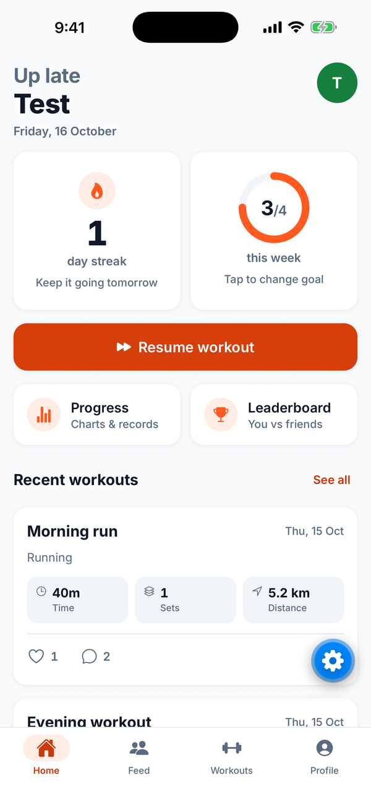<br /><sub><b>Home</b>: streak, weekly goal ring</sub></td>
    <td align="center">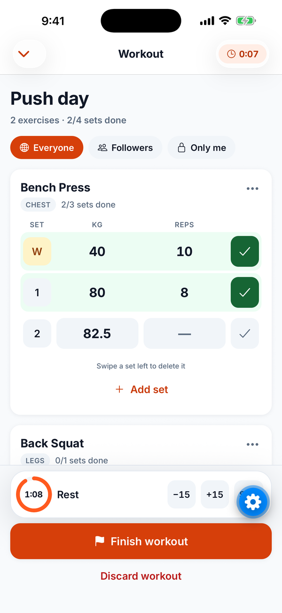<br /><sub><b>Logger</b>: sets, warmups, rest timer</sub></td>
    <td align="center">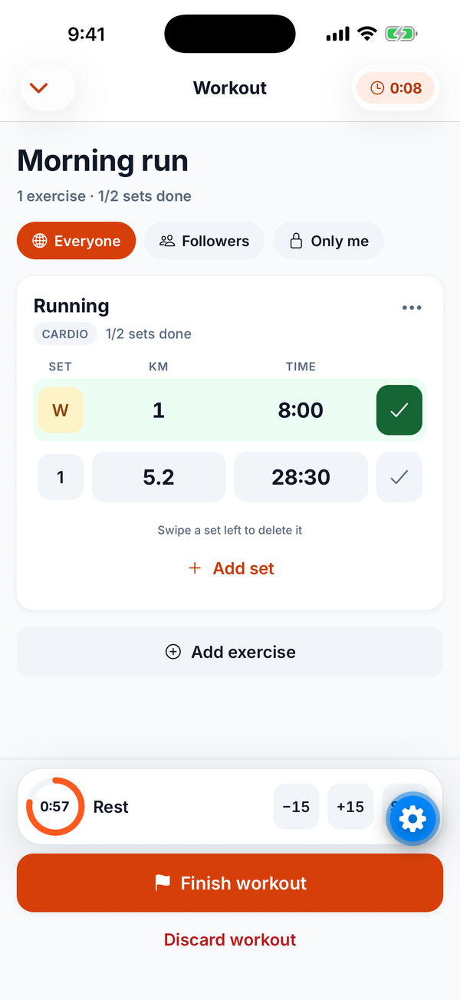<br /><sub><b>Cardio</b>: distance + time</sub></td>
    <td align="center">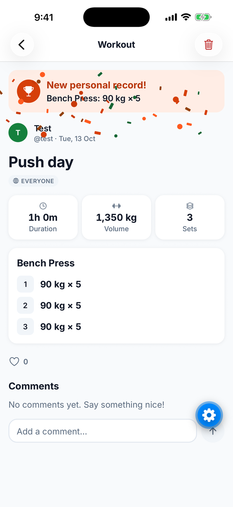<br /><sub><b>New PR</b>: banner + confetti</sub></td>
  </tr>
  <tr>
    <td align="center">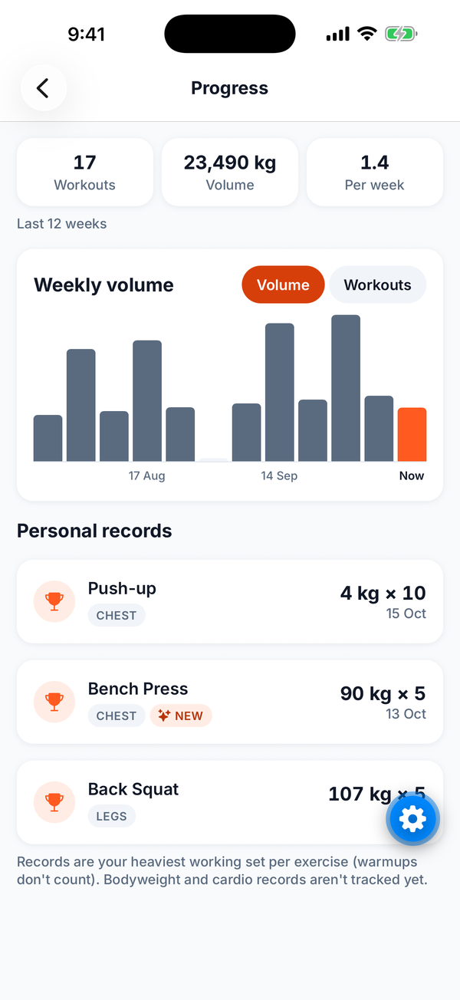<br /><sub><b>Progress</b>: 12-week chart, records</sub></td>
    <td align="center">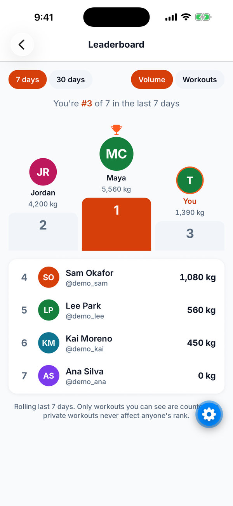<br /><sub><b>Leaderboard</b>: you vs people you follow</sub></td>
    <td align="center">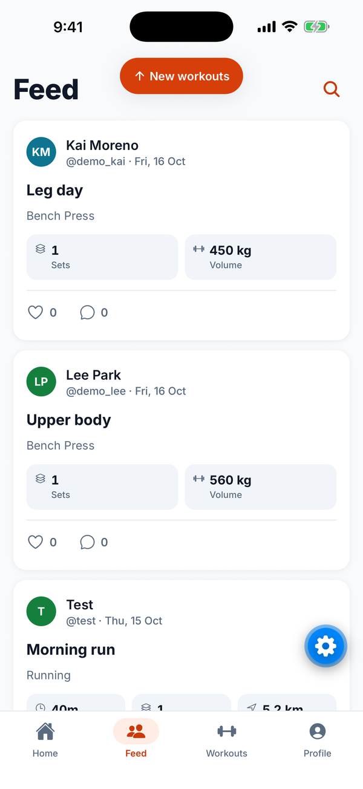<br /><sub><b>Feed</b>: live "New workouts" pill</sub></td>
    <td align="center">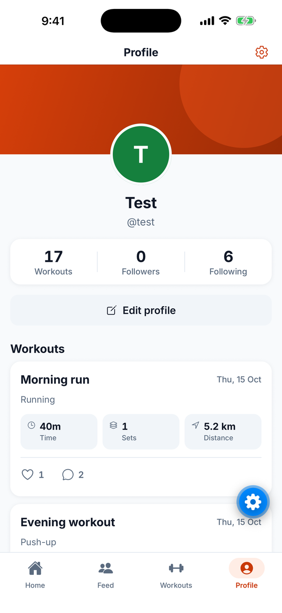<br /><sub><b>Profile</b>: stats, workout history</sub></td>
  </tr>
  <tr>
    <td align="center">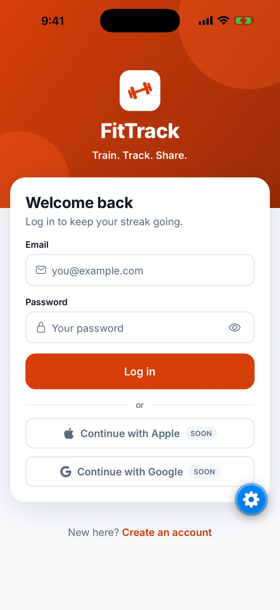<br /><sub><b>Login</b></sub></td>
    <td align="center">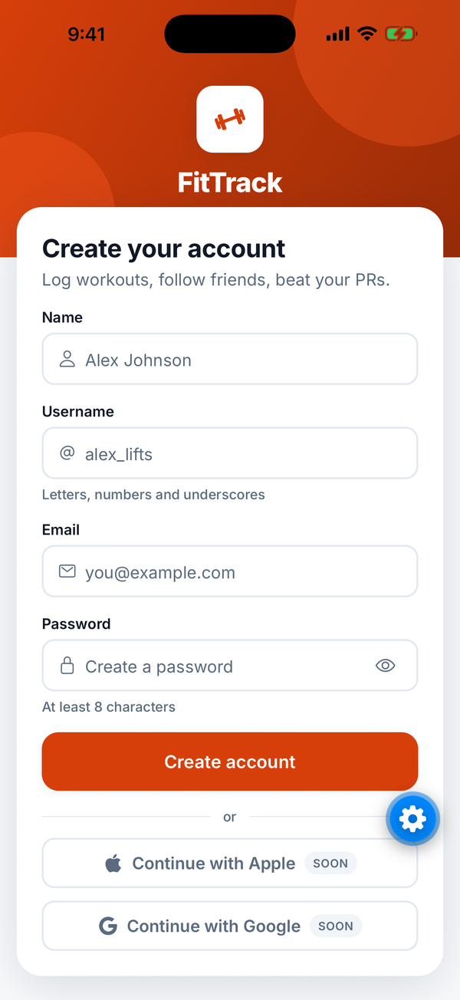<br /><sub><b>Register</b></sub></td>
    <td align="center">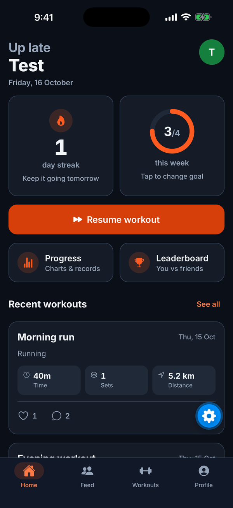<br /><sub><b>Dark mode</b>: Home</sub></td>
    <td align="center">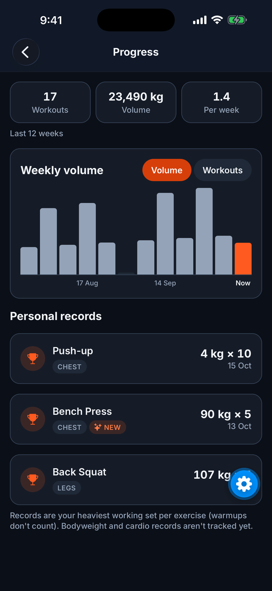<br /><sub><b>Dark mode</b>: Progress</sub></td>
  </tr>
</table>

<sub>Captured on the iOS Simulator (iPhone 17 Pro Max) running in Expo Go. The blue gear in the corner is Expo Go's developer menu button, not part of the app. Data shown is demo data.</sub>

---

## Features

**Workout logging**
- Strength sets (weight × reps) with warmup sets, and cardio sets (distance + time: `30`, `28:30` or `1:05:00`)
- Built for use mid-set: big inputs, 44pt+ touch targets, a haptic tick per completed set, swipe to delete
- A rest timer that survives the app being backgrounded (it stores an end time, not a countdown)
- The draft is saved on the device, so a crash or a killed app loses nothing; versioned migrations keep old drafts loading
- Per-workout privacy: **Everyone / Followers / Only me**, always visible on the workout

**Progress & motivation**
- Home: day streak and a weekly goal ring, both computed on the device in your own time zone (DST-safe)
- Progress: 12-week volume/workout chart and personal records (heaviest working set per exercise)
- A confetti celebration only for a *real* new record, never for your first-ever session of an exercise
- Leaderboard: you vs. people you follow over a rolling 7 or 30 days, by volume or workout count

**Social**
- Follow people, a feed of their workouts, likes, comments and user search
- **Real-time** (Socket.IO): likes and comments appear live on an open workout; toasts when someone likes or comments on yours; a "New workouts" pill when someone you follow posts

**Polish**
- A design system: tokens, light/dark/system theme, the Inter typeface, measured WCAG AA contrast ([DESIGN.md](apps/mobile/DESIGN.md))
- Supports Dynamic Type (large text), Reduce Motion, screen readers, safe areas and the keyboard
- Platform-specific patterns for iOS and Android; custom app icon and splash screen

---

## Tech stack

| Layer | Technology |
|---|---|
| Mobile | React Native 0.86 · Expo SDK 57 · Expo Router · TypeScript |
| State | TanStack Query (server state) · Zustand (client state only) |
| Animation | Reanimated 4 · Gesture Handler · expo-haptics |
| API | Node.js 24 · Express 5 · TypeScript 7 · Zod validation |
| Data | PostgreSQL 17 · Prisma 7 · Redis 7 (cache + rate limiting) |
| Real-time | Socket.IO 4 (WebSocket transport) |
| Auth | JWT access tokens + rotating refresh tokens · expo-secure-store |
| Quality | Jest (server + mobile) · GitHub Actions CI · Docker Compose |

---

## Engineering highlights

The decisions worth asking about. Each is explained in depth in [CODE_TOUR.md](CODE_TOUR.md).

- **One visibility rule, everywhere.** `visibleTo(viewerId)` is a Prisma `where` fragment, so lists, counts, detail pages, likes, comments, the leaderboard and real-time events all filter with the exact same logic. Hidden workouts return 404, not 403, so their existence isn't leaked.
- **Refresh-token rotation with reuse detection.** Every refresh issues a new token and kills the old one. Replaying an old token revokes the whole token family (a stolen-token signal). Tokens are stored hashed, with rate limiting on auth routes.
- **Real-time where events are hints, REST is the truth.** A socket event only says "this changed", so a phone that missed events while offline just refetches on reconnect. Like counts are *set* from the server's absolute value, never `+1`, because your own actions echo back to you.
- **Socket auth with token expiry.** The handshake reuses the REST token check, and the server disconnects a socket when its access token expires. A revoked session can't keep listening longer than it could keep calling the API.
- **Time zones stay on the device.** The app sends "Monday 00:00 in *my* time zone" and the server never guesses. The leaderboard uses rolling windows for the same reason.
- **Personal records in one query** with Postgres `DISTINCT ON`: heaviest set per exercise, ties broken by reps, then by the earliest date (so repeating a record isn't a new one).
- **Idempotent writes:** likes are `PUT`/`DELETE`, not a toggle, so a retried request can't flip a like back off.
- **Cache-aside with explicit invalidation** (Redis) for profile counts. Feed fan-out happens on read.

### Testing

- **99 server tests** (real Postgres + Redis, real sockets on a random port) and **93 mobile tests**
- **Mutation-checked:** for security and correctness rules (privacy, auth, socket fan-out, record ties, DST handling, double counting), each rule was deliberately broken to confirm a test fails
- CI runs typecheck, build and tests for both apps on every push

---

## Project structure

```
fittrack/
├── apps/
│   ├── server/          Express API: modules/{auth,users,workouts,social,stats}, realtime/, prisma/
│   └── mobile/          Expo app: src/app (routes), src/features/*, src/components/ui, src/theme
├── docs/screenshots/    README images
├── docker-compose.yml   Postgres 17 + Redis 7 for local development
├── CODE_TOUR.md         Architecture + design decisions, file by file
└── CLAUDE.md            Working rules and conventions for this repo
```

More docs: [apps/mobile/DESIGN.md](apps/mobile/DESIGN.md) (design system) · [apps/mobile/PRODUCT.md](apps/mobile/PRODUCT.md) (product context and constraints)

---

## Getting started

**Prerequisites:** Node.js 24, Docker Desktop, and Xcode (for the iOS Simulator) or the Expo Go app on a phone.

```bash
# 1. Install dependencies (npm workspaces: server + mobile)
npm install

# 2. Start Postgres and Redis
docker compose up -d --wait

# 3. Configure the API (then set JWT_ACCESS_SECRET, e.g. `openssl rand -base64 48`)
cp apps/server/.env.example apps/server/.env

# 4. Create the schema and seed the exercise catalog
npm run db:migrate -w apps/server
npm run db:seed -w apps/server

# 5. Run the API on http://localhost:4000
npm run dev -w apps/server
```

In a second terminal:

```bash
# 6. Configure and start the app (Metro runs on port 8082)
cp apps/mobile/.env.example apps/mobile/.env   # see the file for emulator / physical-phone URLs
npm run ios -w apps/mobile
```

### Tests and checks

```bash
npm test -w apps/server          # migrates the test database, then runs Jest
npm test -w apps/mobile
npm run typecheck -w apps/server
npm run typecheck -w apps/mobile
```

---

## Roadmap

Built so far, in order:

| Phase | What |
|---|---|
| 0–1 | Monorepo scaffold, Docker, Prisma schema + migrations, test setup |
| 2–3 | JWT auth with rotation and reuse detection; app auth flow with secure token storage |
| 4 | Workout logging API and app (logger, history, detail) |
| 5 | Social: follows, feed, likes, comments, profiles, search, privacy |
| UI | Design system, component library, redesign of every screen, accessibility pass |
| — | Progress and Leaderboard (with server endpoints), cardio logging |
| 6 | Real-time updates with Socket.IO |

Next:
- **Phase 7:** photo uploads to S3 with pre-signed URLs
- **Phase 8:** push notifications (Expo Push)
- **Phase 9:** payments with Stripe, plus deployment

Known gaps: timed non-cardio exercises (e.g. Plank) still log reps; records cover weighted sets only; Android hasn't been verified on a device yet; phone-only (no tablet layouts).
